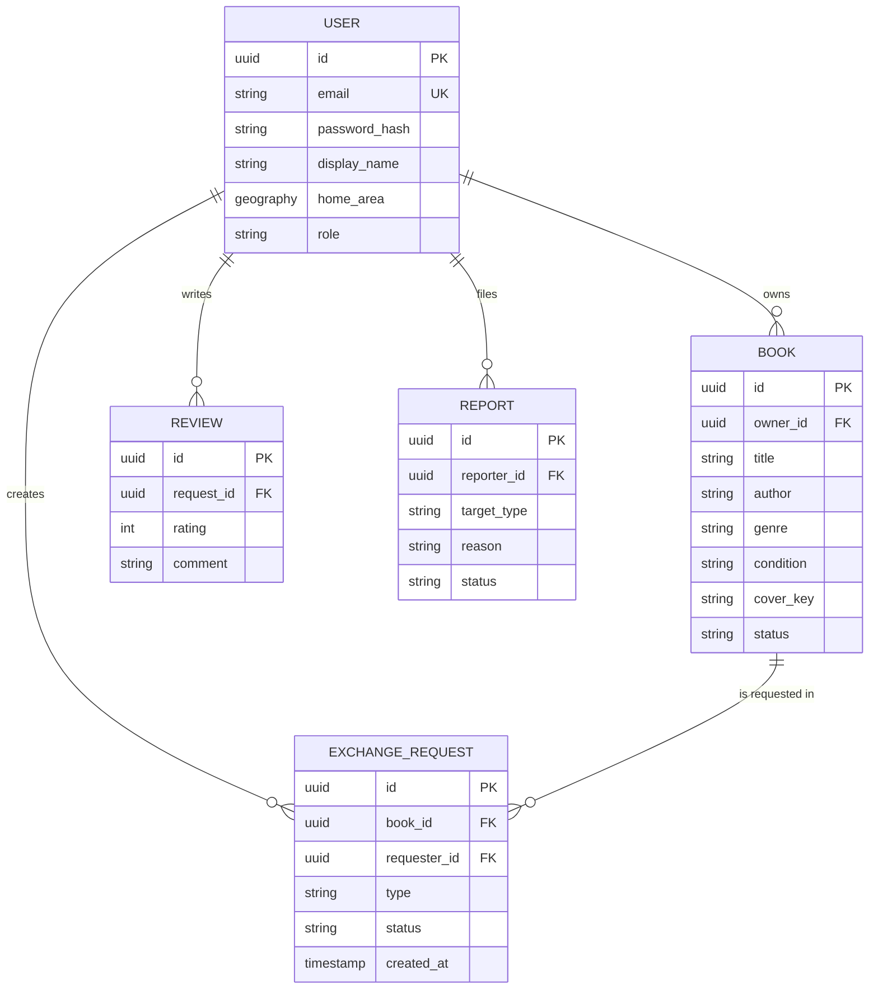
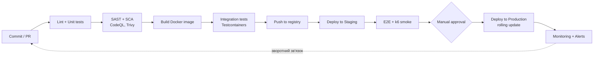
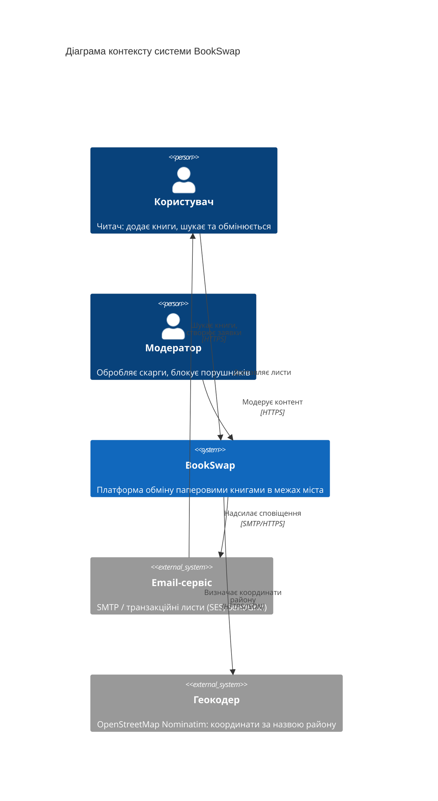
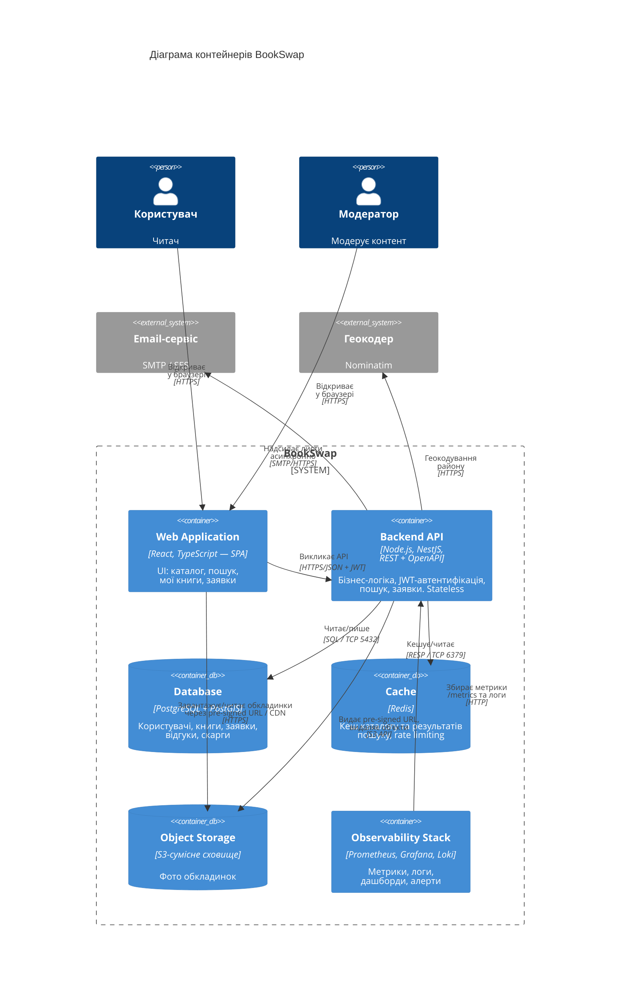
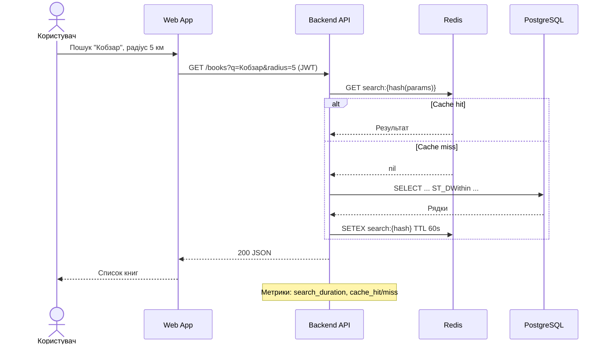
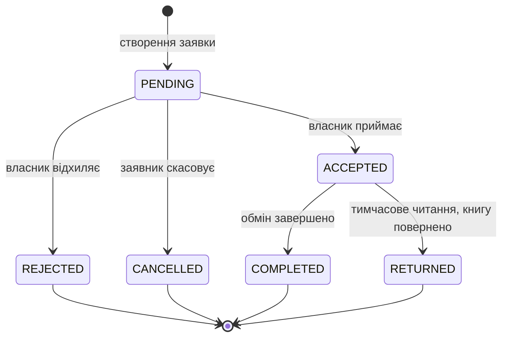
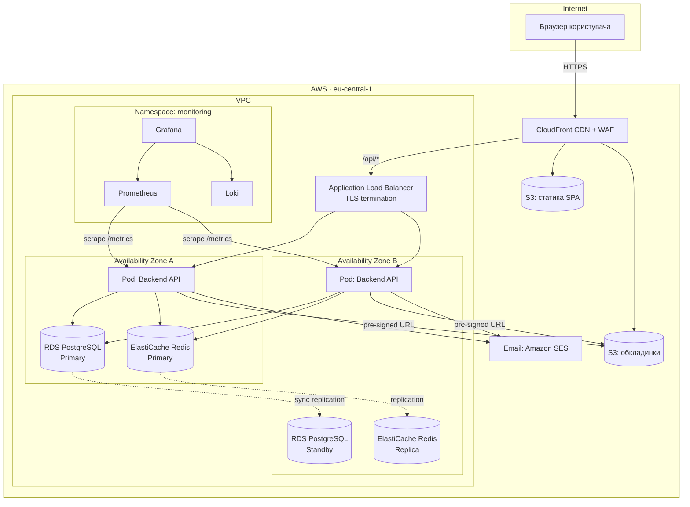

# Лабораторна робота 1 

**Проєкт:** BookSwap — сервіс обміну паперовими книгами у межах міста
**Інструменти:** Structurizr DSL (`workspace.dsl`), Mermaid.js, Markdown ADR (`docs/adr/`)

---

## 1. Бізнес-ідея та функціональні вимоги

### 1.1 Опис ідеї

**BookSwap** — вебсервіс, у якому мешканці одного міста публікують каталог власних паперових книг, знаходять потрібні видання в інших людей поблизу та домовляються про **обмін** або **тимчасове читання**.

**Проблема:** у людей вдома лежать прочитані книги, які ніхто не відкриває, а нові книги дорогі. Існуючі рішення (групи в соцмережах, OLX) не мають структурованого каталогу, пошуку за геолокацією та керування процесом домовленості.

**Цінність:** економія коштів, повторне використання книг, локальна спільнота читачів.

**Свідомі обмеження (scope):** немає платежів, немає WebSockets/чату в реальному часі, немає аналітики в реальному часі. Домовленість відбувається через заявки зі статусами; контакти відкриваються після підтвердження заявки.

**Ключові ролі:**

| Роль | Опис |
|---|---|
| Гість | Переглядає публічний каталог, шукає книги |
| Користувач | Зареєстрований: додає книги, створює заявки, відповідає на заявки |
| Модератор | Опрацьовує скарги, блокує некоректні оголошення та користувачів |

### 1.2 User Stories

| ID | Історія | Критерії прийняття (скорочено) | Пріоритет |
|---|---|---|---|
| US-01 | Як гість, я хочу зареєструватися за email і паролем, щоб користуватися сервісом | Унікальний email; підтвердження пошти; пароль зберігається у вигляді хешу | Must |
| US-02 | Як користувач, я хочу увійти в систему та залишатися авторизованим, щоб не вводити пароль щоразу | Видається access/refresh токен; вихід інвалідовує refresh-токен | Must |
| US-03 | Як користувач, я хочу вказати своє місто/район, щоб бачити книги поруч | Збереження координат району (не точної адреси) | Must |
| US-04 | Як користувач, я хочу додати книгу (назва, автор, жанр, стан, фото обкладинки) у свій каталог | Фото ≤ 5 МБ, формат JPEG/PNG/WebP; книга з'являється в каталозі | Must |
| US-05 | Як користувач, я хочу редагувати, ховати або видаляти свою книгу | Прихована книга не потрапляє в пошук | Must |
| US-06 | Як гість, я хочу шукати книги за назвою, автором, жанром | Пагінація; результат до 1 с на типовому навантаженні | Must |
| US-07 | Як користувач, я хочу фільтрувати книги за відстанню/районом, щоб знайти близькі до мене | Сортування за відстанню; радіус 1–50 км | Must |
| US-08 | Як користувач, я хочу створити заявку на обмін або тимчасове читання чужої книги | Заявка має тип (`SWAP` / `LEND`) і статус `PENDING` | Must |
| US-09 | Як власник книги, я хочу прийняти або відхилити заявку | Статуси `ACCEPTED` / `REJECTED`; заявник отримує сповіщення | Must |
| US-10 | Як учасник прийнятої заявки, я хочу побачити контакти співрозмовника для зустрічі | Контакти видно лише учасникам `ACCEPTED`-заявки | Must |
| US-11 | Як учасник, я хочу позначити обмін завершеним / книгу повернутою | Статуси `COMPLETED` / `RETURNED`; книга знову доступна | Should |
| US-12 | Як користувач, я хочу отримувати email-сповіщення про нові заявки та зміну їх статусу | Лист надсилається асинхронно, збій пошти не блокує дію | Should |
| US-13 | Як користувач, я хочу залишити відгук про партнера після обміну | Оцінка 1–5 + коментар; один відгук на обмін | Could |
| US-14 | Як користувач, я хочу поскаржитися на оголошення або користувача | Скарга потрапляє в чергу модерації | Should |
| US-15 | Як модератор, я хочу переглядати скарги та блокувати книги/користувачів | Дії логуються в журналі аудиту | Should |

### 1.3 Модель домену (спрощено)



---

## 2. Нефункціональні вимоги (NFR) та їх вплив на DevOps

NFR сформульовано вимірювано, щоб їх можна було перевіряти в пайплайні та моніторингу.

| ID | Категорія | Вимога (вимірювана) | Вплив на архітектуру та DevOps-інструменти |
|---|---|---|---|
| NFR-01 | **Масштабованість** (читання) | Система витримує до 500 RPS читання каталогу; читання ≫ запису (приблизно 90/10) | Кешування каталогу в **Redis** (cache-aside), CDN для статики, **stateless API** з горизонтальним масштабуванням (Kubernetes **HPA** за CPU/RPS), балансувальник навантаження |
| NFR-02 | **Продуктивність** | p95 пошуку ≤ 300 мс, p95 решти ендпоінтів ≤ 500 мс | Індекси БД (GIN/GiST), кеш, нагрузкові тести (**k6**) як етап CI/CD, SLO-алерти |
| NFR-03 | **Доступність** | Доступність ≥ 99,5 % на місяць (≈ 3,6 год простою) | БД **Multi-AZ** з автоперемиканням, мінімум 2 репліки API в різних AZ, health/readiness probes, rolling-деплой без простою |
| NFR-04 | **Безпека** | Автентифікація через **JWT** (access 15 хв + refresh 7 днів з ротацією); паролі — Argon2id/bcrypt; весь трафік по HTTPS (TLS 1.2+) | Секрети лише в менеджері секретів (не в Git), SAST/SCA/сканування образів у CI (**Trivy**, **CodeQL**, Dependabot), rate limiting, OWASP Top 10 |
| NFR-05 | **Приватність** | Точні адреси не зберігаються; контакти розкриваються лише після `ACCEPTED`; видалення акаунта (GDPR-подібне) | Модель даних із координатами району, перевірка прав на рівні API, шифрування БД at rest |
| NFR-06 | **Observability** | Метрики, структуровані логи й трейси з першого релізу; бізнес-метрики пошуку та помилок API | **Prometheus** + **Grafana** (метрики), **Loki** (логи), **OpenTelemetry** (трейси), алерти за SLO; `/metrics`, `/health` |
| NFR-07 | **Відновлюваність** | RPO ≤ 24 год (цільово 15 хв через PITR), RTO ≤ 2 год | Автоматичні бекапи БД, версіонування S3-бакета, відновлення перевіряється періодично |
| NFR-08 | **Супроводжуваність / Deployability** | Деплой в production ≥ 1 раз на тиждень, час від merge до production ≤ 30 хв | **CI/CD** (GitHub Actions), **IaC** (Terraform), контейнеризація (Docker), GitOps-подібний підхід, Architecture as Code |
| NFR-09 | **Портативність / Відтворюваність середовищ** | Нове dev-середовище піднімається однією командою за ≤ 15 хв | `docker compose`, однакові образи dev → staging → prod |
| NFR-10 | **Зручність використання** | Адаптивний інтерфейс (mobile-first); WCAG 2.1 AA для основних сторінок | Lighthouse у CI як quality gate |

### 2.1 Ключові бізнес-метрики для observability (NFR-06)

| Метрика | Тип | Навіщо |
|---|---|---|
| `bookswap_search_requests_total{has_results}` | counter | Скільки пошуків і яка частка без результатів |
| `bookswap_search_duration_seconds` | histogram | p95/p99 затримки пошуку (SLO) |
| `bookswap_cache_hits_total` / `bookswap_cache_misses_total` | counter | Ефективність кешу каталогу |
| `bookswap_http_requests_total{route,status}` | counter | Частка 5xx/4xx → error budget |
| `bookswap_exchange_requests_created_total{type}` | counter | Продуктова активність |
| `bookswap_exchange_requests_by_status` | gauge | Воронка заявок |
| `bookswap_auth_failures_total` | counter | Виявлення брутфорсу |
| `bookswap_cover_upload_failures_total` | counter | Здоров'я інтеграції з S3 |

**SLO-приклади:** 99,5 % запитів успішні (не 5xx); 95 % пошуків ≤ 300 мс.

---

## 3. Життєвий цикл та методологія

### 3.1 Обрана методологія: Scrum + DevOps-практики

- **Scrum:** спринти по 2 тижні, ролі Product Owner / Scrum Master / Dev-команда, артефакти — Product Backlog (User Stories з розділу 1), Sprint Backlog, Increment.
- **Події:** Sprint Planning, Daily, Sprint Review, Retrospective.
- **Definition of Done (DoD)** включає DevOps-критерії: код у PR пройшов review, unit/integration-тести зелені, сканування безпеки пройдено, зміна розгорнута на staging, додано метрики/логи, оновлено ADR/діаграми за потреби.
- **Плануємо спринти:**

| Спринт | Фокус |
|---|---|
| 0 | Архітектура (ця лабораторна), репозиторій, CI-скелет, `docker compose` |
| 1 | Реєстрація/логін (JWT), IaC-базис (мережа, БД), базова observability |
| 2 | Каталог книг, завантаження обкладинок у S3 |
| 3 | Пошук, геофільтр, кешування Redis |
| 4 | Заявки на обмін, сповіщення, модерація |
| 5 | Hardening: нагрузкові тести, алерти, DR-перевірка |

### 3.2 Від класичних моделей (Waterfall / RUP) до безперервної доставки

| Аспект | Waterfall / класичний RUP | Scrum + DevOps (BookSwap) |
|---|---|---|
| Структура | Фази (Inception → Elaboration → Construction → Transition), великі ітерації | Короткі спринти, безперервний потік змін |
| Відповідальність | Dev передає збірку Ops («стіна нерозуміння») | Команда відповідає за продукт «you build it, you run it» |
| Релізи | Рідкісні, великі, ризиковані | Малі, часті, автоматизовані |
| Вимоги | Фіксуються наперед у великих документах | Backlog еволюціонує; рішення — у коротких ADR |
| Тестування | Окрема фаза наприкінці | Shift-left: тести в кожному коміті |
| Інфраструктура | Налаштовується вручну адмінами | Infrastructure as Code, версіонування в Git |
| Документація | Довгі специфікації, швидко застарівають | Architecture as Code (Structurizr/Mermaid) поряд із кодом |
| Зворотний зв'язок | Після релізу, через місяці | Моніторинг і метрики майже миттєво |

RUP дав корисні ідеї (архітектурно-орієнтований підхід, ітеративність, ризик-орієнтованість), але його ітерації залишаються довгими, а «передача в експлуатацію» — окремою фазою. DevOps замикає цикл: **Plan → Code → Build → Test → Release → Deploy → Operate → Monitor → Plan**.

### 3.3 Як DevOps інтегрується в життєвий цикл Scrum

| Етап Scrum / життєвого циклу | DevOps-практика | Інструменти |
|---|---|---|
| Планування (Planning, Backlog) | Backlog як код/issue, NFR як acceptance-критерії | GitHub Projects / Issues |
| Розробка | Trunk-based / короткі feature-гілки, PR + code review, pre-commit хуки | Git, GitHub |
| Збірка (Build) | Автоматична збірка та контейнеризація при кожному push | GitHub Actions, Docker |
| Тестування | Unit → Integration → E2E, SAST, SCA, лінтери, нагрузкові тести | Jest/pytest, Testcontainers, Trivy, CodeQL, k6 |
| Реліз | Семантичне версіонування, артефакти в реєстрі | GHCR / ECR |
| Розгортання (Deploy) | Автодеплой на staging, затвердження → production, rolling update, rollback | Terraform, Helm, Kubernetes |
| Експлуатація | IaC, autoscaling, бекапи | Terraform, K8s HPA |
| Моніторинг | Метрики/логи/трейси, алерти за SLO → зворотний зв'язок у Backlog | Prometheus, Grafana, Loki, OpenTelemetry |
| Sprint Review / Retro | DORA-метрики (частота деплоїв, lead time, change failure rate, MTTR) | Grafana / GitHub API |
| Архітектура | Architecture as Code, ADR через PR | Structurizr DSL, Mermaid |

### 3.4 Цільовий CI/CD-пайплайн



---

## 4. Архітектурне проєктування

### 4.1 Архітектурний стиль

**Модульний моноліт** (один Backend API, розбитий на модулі: Auth, Users, Books, Exchange, Moderation, Notifications) із зовнішніми компонентами: PostgreSQL, Redis, S3.

Обґрунтування: невелика команда, чітка доменна область, низька складність операцій; при цьому API **stateless**, тому він масштабується горизонтально. Межі модулів дозволять виділити сервіси пізніше, якщо виникне потреба.

### 4.2 C4 — Рівень 1: System Context



### 4.3 C4 — Рівень 2: Container



**Опис контейнерів:**

| Контейнер | Технологія | Відповідальність | NFR |
|---|---|---|---|
| Web Application | React + TypeScript, статика через CDN | Інтерфейс, зберігання access-токена в пам'яті | NFR-01, NFR-10 |
| Backend API | Node.js / NestJS, REST, OpenAPI | Бізнес-логіка, JWT, валідація, метрики | NFR-02, 03, 04, 06 |
| Database | PostgreSQL + PostGIS | Транзакційні дані, геопошук | NFR-03, 05, 07 |
| Cache | Redis | Кеш каталогу, rate limiting | NFR-01, 02 |
| Object Storage | S3 | Фото обкладинок (завантаження напряму через pre-signed URL) | NFR-01, 07 |
| Observability Stack | Prometheus/Grafana/Loki | Метрики, логи, алерти | NFR-06 |

### 4.4 Модель 4+1: відображення на архітектуру

| View | Для BookSwap |
|---|---|
| Logical | Модулі домену: Auth, Users, Books, Exchange, Moderation (див. ER-діаграму) |
| Process | Асинхронна відправка листів, cache-aside читання, життєвий цикл заявки |
| Development | Монорепозиторій: `frontend/`, `backend/`, `infra/`, `docs/` |
| **Physical (Deployment)** | Див. діаграму нижче — **ключовий вигляд для DevOps** |
| Scenarios (+1) | User Stories US-04, US-06, US-08–US-10 |

**Сценарій для вигляду процесів (пошук із кешем):**



**Життєвий цикл заявки:**



### 4.5 Deployment View (фізичний вигляд / мапінг контейнерів на хмару)

Цільова платформа: **AWS, регіон eu-central-1** (еквіваленти в іншому хмарному провайдері можливі).



**Мапінг контейнер → інфраструктура:**

| C4-контейнер | Цільове розгортання | Масштабування / HA |
|---|---|---|
| Web Application | S3 (статика) + CloudFront (CDN) | CDN-кеш, глобальне розповсюдження |
| Backend API | Docker-образ у Kubernetes (EKS) Deployment | 2–6 реплік (HPA), розміщення в ≥ 2 AZ, rolling update |
| Database | Amazon RDS PostgreSQL | Multi-AZ, автобекапи + PITR, read replica за потреби |
| Cache | Amazon ElastiCache for Redis | Primary + replica в різних AZ |
| Object Storage | Amazon S3 | Версіонування, lifecycle-правила, шифрування |
| Observability | Prometheus/Grafana/Loki у namespace `monitoring` | Збереження метрик на persistent volume |

**Середовища:**

| Середовище | Призначення | Інфраструктура |
|---|---|---|
| Local | Розробка | `docker compose`: API + PostgreSQL + Redis + MinIO (S3) + Prometheus/Grafana |
| Staging | Інтеграційні/E2E-тести, демо | Зменшена копія production (Terraform, ті самі модулі) |
| Production | Користувачі | Повна конфігурація, описана через Terraform |

### 4.6 Structurizr DSL

Повна модель знаходиться у файлі [`workspace.dsl`](workspace.dsl). Із однієї моделі генеруються три представлення: **System Context**, **Container**, **Deployment (Production)**. Перегляд: Structurizr Lite (`docker run -it --rm -p 8080:8080 -v $PWD:/usr/local/structurizr structurizr/lite`) → <http://localhost:8080>.

---

## 5. Architecture Decision Records

Журнал рішень зберігається в `docs/adr/` у форматі MADR-подібного шаблону (Title / Status / Context / Decision / Consequences).

| № | Рішення | Статус | Файл |
|---|---|---|---|
| ADR-0001 | PostgreSQL (+ PostGIS) як основна база даних | Accepted | [`docs/adr/0001-use-postgresql-as-primary-database.md`](docs/adr/0001-use-postgresql-as-primary-database.md) |
| ADR-0002 | Redis і патерн cache-aside для кешування каталогу | Accepted | [`docs/adr/0002-use-redis-cache-aside-for-catalog.md`](docs/adr/0002-use-redis-cache-aside-for-catalog.md) |

Подальші кандидати на ADR: модульний моноліт vs мікросервіси; JWT access/refresh vs серверні сесії; Terraform як IaC; вибір стеку спостережуваності.

---

## 6. Трасування: від вимог до рішень

| Вимога | Архітектурне рішення | DevOps-наслідок |
|---|---|---|
| NFR-01 Масштабування читання | Redis cache-aside, stateless API, CDN | HPA, дашборд cache hit ratio |
| NFR-03 Доступність | Multi-AZ RDS, ≥ 2 pods у різних AZ | Readiness probes, rolling update |
| NFR-04 Безпека | JWT, TLS, WAF, секрети у Secrets Manager | SAST/SCA/Trivy у CI, ротація секретів |
| NFR-06 Observability | `/metrics`, структуровані логи, OpenTelemetry | Prometheus/Grafana/Loki з першого спринту |
| NFR-08 Deployability | Docker-образи, Terraform | CI/CD-пайплайн, staging → production |
| US-04 Обкладинки | S3 + pre-signed URL | Окремий бакет, lifecycle, бекап/версіонування |
| US-07 Геопошук | PostgreSQL + PostGIS | Міграції БД (Flyway/Prisma) у пайплайні |

---

## 7. Висновки

У роботі бізнес-ідею BookSwap перетворено на архітектурне бачення: сформовано User Stories та вимірювані NFR; обрано Scrum з вбудованими практиками DevOps (CI/CD, IaC, shift-left, моніторинг); побудовано діаграми C4 (Context, Container) та Deployment View як Architecture as Code (Structurizr DSL, Mermaid); зафіксовано два перші ADR. Саме NFR (масштабування читання, доступність, безпека, observability) визначили вибір Redis, Multi-AZ, Kubernetes із HPA, JWT та стека Prometheus/Grafana/Loki — це база для наступних лабораторних робіт (IaC, CI/CD, контейнеризація, моніторинг).

## Структура репозиторію

```text
.
├── README.md                  # цей звіт
├── workspace.dsl              # модель C4 у Structurizr DSL
└── docs/
    └── adr/
        ├── 0001-use-postgresql-as-primary-database.md
        └── 0002-use-redis-cache-aside-for-catalog.md
```

--------------------------------------------------------------------------------------------

# BookSwap — Лабораторна робота 2: Контейнеризація та локальне середовище

Сервіс обміну паперовими книгами. Реалізація C4 Container View у Docker Compose.

## Архітектура контейнерів

| Сервіс | Образ | Мережі | Порт назовні |
|---|---|---|---|
| frontend | nginx-unprivileged (статика Vite) | frontend-net | 8080 |
| backend | node:22-alpine (Express API, JWT) | frontend-net, backend-net | — |
| db | postgres:17-alpine | backend-net | — |
| redis | redis:7-alpine (кеш каталогу) | backend-net | — |
| minio | minio (S3 для обкладинок) | backend-net | — |

`backend-net` має `internal: true`: БД, Redis та MinIO недосяжні з Frontend-контейнера й ззовні.

## Запуск

```bash
cp .env.example .env      # змініть паролі та JWT_SECRET
docker compose up --build
```

Відкрийте http://localhost:8080.

## Перевірка вимог лабораторної

```bash
# 1. Healthcheck-и: усі сервіси мають статус healthy
docker compose ps

# 2. Збереження даних: створіть користувача й книгу в UI, потім
docker compose down && docker compose up -d
# книги залишаються (named volume pgdata)

# 3. Ізоляція мереж: з Frontend до БД дістатися не можна
docker compose exec frontend sh -c "nc -zv -w 2 db 5432"      # має завершитись помилкою
docker compose exec backend  sh -c "nc -zv -w 2 db 5432"      # успіх

# 4. Non-root
docker compose exec backend id        # uid=1000(node)
docker compose exec frontend id       # uid=101(nginx)

# 5. Розмір образів
docker images | grep bookswap

# 6. Кеш Redis: другий запит повертає X-Cache: HIT
curl -si http://localhost:8080/api/books | grep -i x-cache
curl -si http://localhost:8080/api/books | grep -i x-cache

# 7. Лінтинг (опціонально)
hadolint backend/Dockerfile frontend/Dockerfile
```

## Відповідність 12-Factor

- **III Config:** уся конфігурація — змінні оточення (`backend/src/config.js`, `.env`); без значення сервіс не стартує.
- **VI Processes:** Backend stateless; стан у PostgreSQL/Redis/MinIO (томи).
- **IX Disposability:** обробка SIGTERM/SIGINT, `init: true`, швидкий старт.

## ADR

[`docs/adr/0003-container-base-images-and-network-isolation.md`](docs/adr/0003-container-base-images-and-network-isolation.md)

--------------------------------------------------------------------------------------------

# BookSwap — Лабораторна робота 3: CI та контроль якості коду

## Стратегія гілок: GitHub Flow
`main` завжди готова до деплою → `feature/*` → Pull Request → CI + 1 approve → squash merge.
Захист `main`: `scripts/protect-main.sh` (або Settings → Branches → Rulesets).

## Пайплайн (`.github/workflows/ci.yml`)
```
PR / push ─┬─ Lint Dockerfiles (hadolint)
           ├─ Lint (backend, frontend)      ─┐
           ├─ Test (backend, frontend)       ├─► Build → Trivy image scan → Push to GHCR
           └─ Security: Trivy fs (CVE+secret)┘      (push лише на main і v*-теги)
```

## Образи
`ghcr.io/shouldbec00l/bookswap/backend` та `.../frontend`, теги `sha-<short>`, `X.Y.Z`, `main`. Без `latest`.

```
docker pull ghcr.io/shouldbec00l/bookswap/backend:sha-<short>
```

## Реліз
```
git tag v1.0.0 && git push origin v1.0.0
```

## ADR
[`docs/adr/0004-ci-cd-platform-versioning-and-quality-gates.md`](docs/adr/0004-ci-cd-platform-versioning-and-quality-gates.md)

--------------------------------------------------------------------------------------------
# Лабораторна робота 4: Інфраструктура як код (Terraform + Ansible)

BookSwap на **AWS Free Tier** (eu-north-1): Terraform створює мережу та VM, Ansible готує ОС і Docker.
Рішення зафіксовано в [ADR-0004](../docs/adr/0005-iac-aws-terraform-state-and-responsibilities.md).

## Що створюється

```
Internet ──► Security Group (22 тільки з вашого IP, 80, 443)
              └─ VPC 10.0.0.0/16 ─ public subnet 10.0.1.0/24 ─ EC2 t3.micro (Ubuntu 24.04) + Elastic IP
                                                                  └─ Docker Compose (Лаб. 2)
```

| Компонент Deployment View | Реалізація |
| --- | --- |
| VPC, підмережа, маршрути | `aws_vpc`, `aws_subnet`, `aws_internet_gateway`, `aws_route_table` |
| Firewall | `aws_security_group` (22/80/443) + UFW + fail2ban |
| Сервер | `aws_instance` + `aws_eip`; IP — у `terraform output public_ip` |
| БД / Redis / MinIO | Docker Compose у `internal`-мережі; назовні не публікуються |

## Передумови

Terraform ≥ 1.6 (або OpenTofu), Ansible ≥ 2.15, AWS CLI з налаштованими обліковими даними (`aws configure`), SSH-ключ (`ssh-keygen -t ed25519`).

## 1. Terraform

```bash
cd infra/terraform
cp terraform.tfvars.example terraform.tfvars   

terraform init
terraform fmt -check -recursive
terraform validate
terraform plan -out=tfplan
terraform apply tfplan

terraform output public_ip
```

`apply` також записує `../ansible/inventory.ini` з IP сервера.

## 2. Ansible

```bash
cd ../ansible
ansible-galaxy collection install -r requirements.yml
ansible webservers -m ping
ansible-playbook site.yml          # 1-й запуск: changed > 0
ansible-playbook site.yml          # 2-й запуск: changed=0 (ідемпотентність)
```

Що робить плейбук (ролі `common`, `docker`, `app_dirs`):

- `apt upgrade` (safe), базові пакети;
- UFW (deny incoming; allow 22, 80, 443), fail2ban для sshd, вимкнення входу за паролем;
- Docker Engine + Compose plugin з офіційного репозиторію, користувач у групі `docker`;
- каталоги `/opt/bookswap/{data,backups,logs}`.

## 3. Перевірка

```bash
ssh ubuntu@$(terraform -chdir=../terraform output -raw public_ip) \
  'docker --version && docker compose version && id && sudo ufw status verbose && ls -l /opt/bookswap'
```

Перевірка закритих портів (з вашої машини; очікується timeout):

```bash
nc -zv -w 3 <IP> 5432; nc -zv -w 3 <IP> 6379; nc -zv -w 3 <IP> 9000
```
